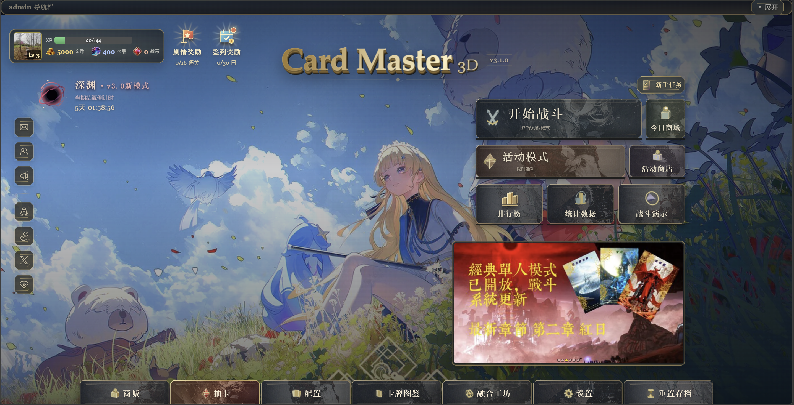
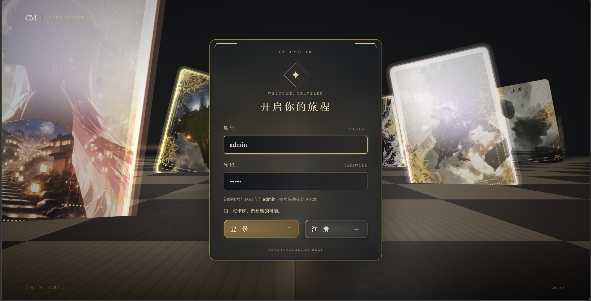
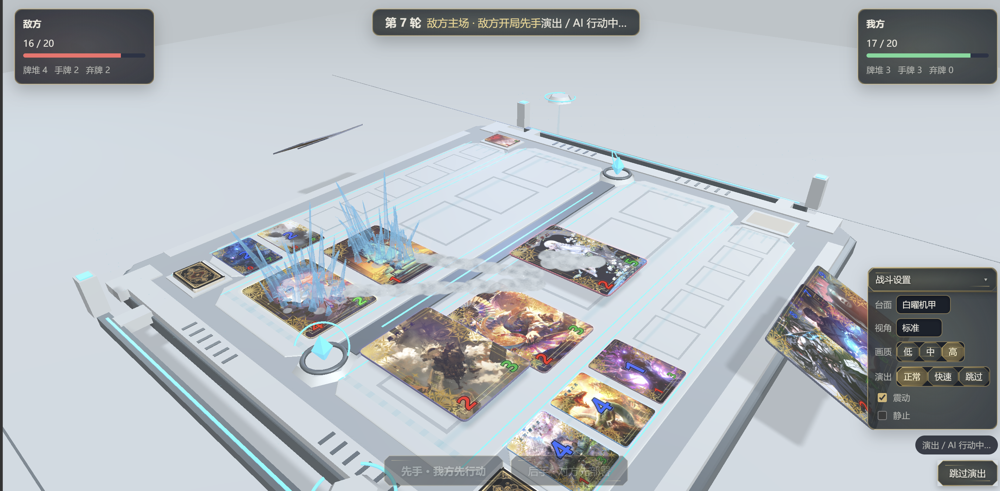
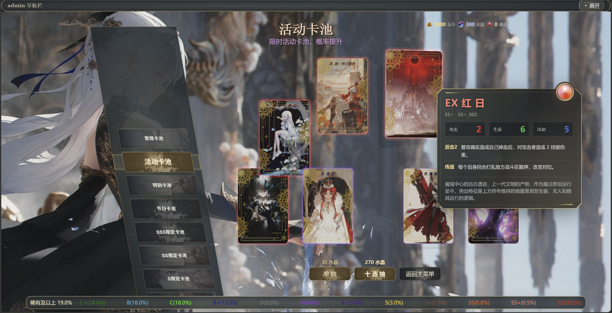
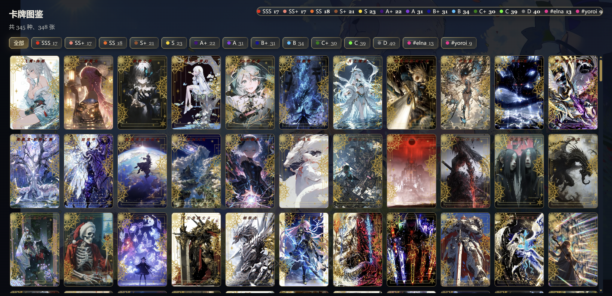
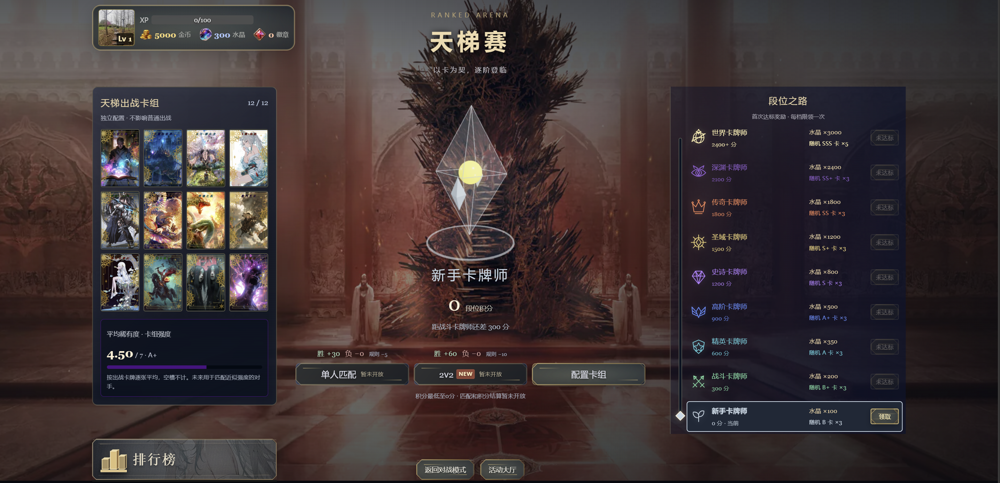
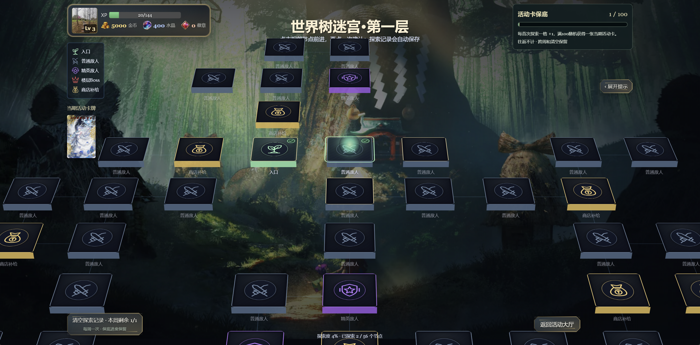
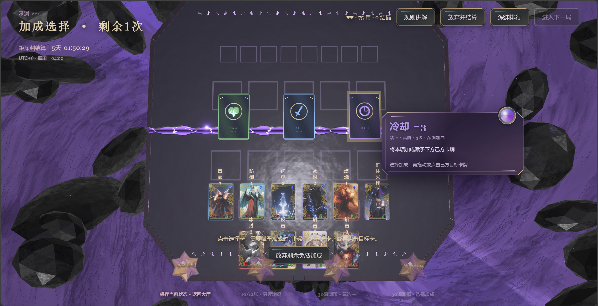
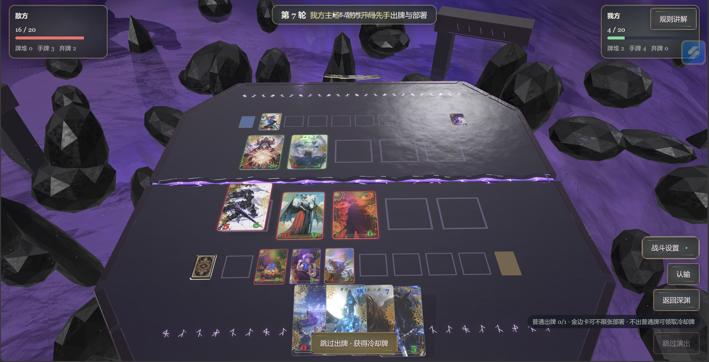

# Card Master 3D

使用 React、TypeScript 与 Three.js 开发的卡牌战斗游戏：实体卡牌与立体技能特效，提供深渊挑战、全屏 3D 单人战役、世界树迷宫、本地选卡对战，协力世界 Boss、三日轮换高难挑战，以及抽卡、组卡、商店和融合；提供天梯大厅与本地排行榜。

**当前版本：v3.3 · 协力作战、高难挑战与控制特性更新**（2026-10-15）

[游戏规则总文档](docs/GAME_RULES.md) · [Trait 对照表](docs/TRAIT_REFERENCE.md)

## 快速开始

需要 **Node.js >= 22.12.0**。

```bash
npm install
npm run dev
```

开发地址：`http://127.0.0.1:5173`。

进入后会播放星空与巨型卡牌盘面的 3D 开场，提示出现后点击任意位置登录。演示账号 / 密码：**`admin` / `admin`**；新手账号 / 密码：**`1234` / `1234`**，初始零资源并拥有 D_001～D_012 十二张卡。新账号上线默认收到新手奖励邮件，在大厅左侧邮箱领取 **300 水晶＋3000 金币**；也可注册独立本地账号。已有账号和存档不覆盖。


## 界面展示

### 主界面



| 登录开场 | 卡牌战斗 |
| --- | --- |
|  |  |

| 抽卡界面 | 卡牌图鉴 |
| --- | --- |
|  |  |

| 天梯大厅 | 世界树迷宫 |
| --- | --- |
|  |  |

| 深渊大厅 | 深渊对战 |
| --- | --- |
|  |  |

| 命令 | 用途 |
| --- | --- |
| `npm run dev` | 启动开发服务器 |
| `npm run typecheck` | TypeScript 类型检查 |
| `npm run test` | Vitest 单元测试 |
| `npx playwright test` | Playwright 浏览器用例 |
| `npm run build` | 类型检查与生产构建 |
| `npm run preview` | 本地预览生产构建 |

开发开关：`?day=YYYYMMDD` 固定存档时钟，`?failsave=1` 模拟存档写入失败，`?audio=0` 强制静音，`?audio=1` 尝试解锁音频。

## 玩法与界面

| 功能 | 内容 |
| --- | --- |
| 登录与开场 | 本地账号登录 / 注册、独立存档；星空标题、下坠盘面、两侧落卡巡游与翻卡扩展进入大厅 |
| 数据统计与新手任务 | 世界树、天梯最高段位、战役、收藏与深渊统计；非深渊对战、抽卡、融合累计任务和无限循环奖励|
| 主界面奖励 | 旗帜剧情奖励与日历签到奖励；金属纹理横向节点轨道、1-1 至 4-4 通关礼、累计 30 日签到，进度随玩家存档保存 |
| 深渊模式 | 常驻3D盘面、拖放培养、三选一招募、递进关卡与无尽；通关五选三卡包、独立五档周奖励、最高通关排行与金紫水晶入口 |
| 单人战役 | 全屏多岛 3D 世界、自由观察与区域聚焦、场景内关卡旗标和滑出详情；六章共 24 个关卡入口；第 4–6 章敌阵由 admin 配置 |
| 天梯大厅 | 专用卡组、强度显示、九档段位、积分预览与达标领奖；单人 / 2v2 匹配待开放 |
| 排行榜 | 主界面 / 天梯 / 深渊可查看，天梯榜、收藏榜与深渊最高通关榜；本地演示数据 |
| 世界树迷宫 | 倾斜节点地图、手动侧栏、补给优惠与免费刷新、百次首探活动卡保底、每周清空一次 |
| 本地任选对战 | 28 张候选轮流选牌，各选 12 张；支持同机双人操作与上方 AI |
| 演示战斗与实验台 | 自动对局、技能展示；支持正常、快速与跳过演出 |
| 抽卡 | 卡池选择、概率分布、单抽与十连；实体卡落位、翻面与稀有卡聚焦，完成后可查看或继续抽卡 |
| 图鉴与配置 | 稀有度筛选、卡牌检视与收藏率；三套普通卡组及独立天梯卡组，每组最多 12 张，候选区每行 6 张 |
| 商店 | 常规 / 活动货架、货币购买与按日刷新 |
| 融合工坊 | 五张材料换一张；分层立体祭坛、固定斜俯视与圆环法阵汇聚演出 |
| 协力作战 | 本地多账号共享世界Boss生命，D至SSS阶段敌阵；真实累计伤害榜、里程碑与阶段排名奖励 |
| 高难挑战 | 每三日轮换公开12张敌阵，不限次数；首次通关与无伤、速胜、手牌目标分别领奖 |
| 活动大厅 | 滚轮进入世界树、深渊、协力作战、天梯与高难挑战，保留活动商店 |
| 设置与存档 | 画质、台面、视角、演出速度、震动、静止、音量与存档导入 / 导出 |

新增台面 **云顶**：直接以白云的平坦顶面承托卡牌，金色细线勾勒战斗区域，周围漂浮云团缓慢移动，上方蓝天与远处阳光、下方柔白云雾构成明亮的云海背景。可在设置或战斗设置中选择，支持画质档位和减少动态。

两个新活动模式的期次、Boss阶段数值、奖励和保存规则见 [协力作战与高难挑战说明](docs/ACTIVITY_MODES.md)。协力目前为同一浏览器站点内的账号共享，不跨设备。

## 技术栈与目录

| 层 | 选择 | 用途 |
| --- | --- | --- |
| 工程 | Vite + React + TypeScript | 本地开发、构建，类型化卡牌和事件 |
| 渲染 | Three.js / React Three Fiber | 用组件组织场景，直接使用 Three.js 处理高频更新 |
| 辅助 | Drei | RoundedBox、贴图加载、必要的文字与环境辅助 |
| 界面与状态 | React DOM + CSS；Zustand 管理低频应用状态 | 中文说明、按钮、卡池/收藏列表、战斗快照 |
| 战斗规则 | 独立 TypeScript 模块 | 不依赖 React、Three.js、DOM 或文件 IO |
| 演出 | 自建轻量时间轴 + useFrame | 空间位移、并行粒子、镜头与命中反馈；避免多套时间轴 |
| 后处理 | @react-three/postprocessing，按质量档启用 | Bloom 与必要抗锯齿；P1 验证后锁定组合 |
| 数据保存 | IndexedDB 事务；localStorage 仅放少量设置 | 游戏进度与多字段操作统一提交 |
| 验证 | Vitest + Playwright + 开发调试页 | 核心规则、完整交互流程、浏览器实际渲染 |

| 目录 | 内容 |
| --- | --- |
| `src/domain/` | 战斗、技能、抽卡、经济、战役、融合与存档数据的纯逻辑 |
| `src/rendering/` | 卡牌、战桌、技能特效、抽卡舞台与融合祭坛 |
| `src/scenes/` | 各玩法界面与场景拼装 |
| `src/ui/` | 菜单、卡牌介绍、详细检视与通用控件 |
| `src/state/` | 玩家存档、设置、界面状态与 React 桥接 |
| `src/services/` | 存档存储、导出下载与音效服务 |
| `src/data/` | 卡牌、技能、关卡、卡池、商店、融合配置与素材清单 |
| `public/assets/` | 本地卡面、原画、背景、图标与特效纹理 |
| `scripts/` | 离线数据与素材处理工具 |
| `tests/unit/`、`tests/browser/` | 规则单测与浏览器用例 |

## 卡牌制作与素材

卡牌数据与卡面由同级工具仓库 [`cardmaker`](../cardmaker) 制作：选原画、裁剪构图、填写数值与特性，然后导出到本项目。主要输出为 `src/data/cards.json`、`src/data/assets.manifest.json`、`public/assets/card/{thumbnail,battle,detail}/` 与原画。手工调整这些文件时，需要留意后续工具导出可能覆盖相应内容。

运行所需派生纹理随仓库提交，本地参考工程 `assets-library/` 不入库。素材与移植代码的来源、许可和文件对应关系见 [assets-sources.json](assets-sources.json)。

- 战桌、材质、光照与天气系统使用 [Chessboard-three.js](https://github.com/ibra-kdbra/Chessboard-three.js) 的部分代码（MIT）。
- 部分技能 Shader 来自 [LinearAbiltyCastingThreeJS](https://github.com/achrefelouafi/LinearAbiltyCastingThreeJS)（MIT），火、冰、雷等技能按本项目战场尺寸与卡面位置调整。
- 炮击、爆裂与远射等效果使用 [three.quarks](https://github.com/Alchemist0823/three.quarks) 粒子系统；具体实现与素材登记见 [战斗特效文档](docs/BATTLE_VFX.md)。
- `pokemon-cards-css` 是 Svelte/CSS 的全息表现参考。该仓库标记 GPL-3.0；只作视觉参考，不直接复制实现或使用插画。[原仓库](https://github.com/simeydotme/pokemon-cards-css)
- [Poly Haven](https://polyhaven.com/license) | HDRI、桌面/石材 PBR、少量装饰模型 | 素材许可为 CC0；下载适当分辨率并本地化 |
- [Kenney Particle Pack](https://kenney.nl/assets/particle-pack) | 火花、烟、星光等粒子图集 | 页面标记 CC0，整理图集后本地加载 |

建立 `assets-sources.json` 记录来源 URL、许可、原始文件与转换产物；
发布产物不依赖第三方 CDN、在线字体或实时素材下载。

## 文档与当前限制

| 文档 | 内容 |
| --- | --- |
| [GAME_RULES.md](docs/GAME_RULES.md) | 当前战斗规则、操作流程与 Trait 功能总表 |
| [LADDER.md](docs/LADDER.md) | 天梯大厅、独立卡组、段位奖励与本地排行榜 |
| [TRAIT_REFERENCE.md](docs/TRAIT_REFERENCE.md) | 按功能合并整理的 Trait 对照表 |
| [AI_SYSTEM.md](docs/AI_SYSTEM.md) | 人机机制、难度、离线评测、权重学习与小模型训练施工状态 |
| [BATTLE_VFX.md](docs/BATTLE_VFX.md) | 技能动画、参考工程与许可 |
| [VISUAL_SPEC.md](docs/VISUAL_SPEC.md) | 视觉规范 |
| [UI_THEME.md](docs/UI_THEME.md) | 金边控件、原画按钮与 admin 导航栏 |


## 更新日志

### v3.3 — 2026-10-15 · 协力作战、高难挑战与控制特性

- 开放协力作战：同一浏览器站点内的多账号共享世界 Boss 生命，敌阵从 D 至 SSS 分阶段提升；加入真实伤害排名、个人里程碑和阶段排名奖励，结算凭据支持去重与失败恢复。
- 开放每三日轮换的高难挑战：公开敌方卡组、不限挑战次数；首次胜利及无伤、少于15回合、剩余普通手牌超过6张目标分别领奖，支持多次挑战补齐目标。
- 完成天崩、地裂：按飞行 / 地面分类的上场群体技能伤害，新增无火落石与土黄色岩柱演出；完成魅惑及操纵／傀儡，加入反向本体攻击、对位操纵光环、粉红／橙色卡面遮罩及实验台预览。
- 新增邮箱和新手奖励邮件（300水晶＋3000金币）；提供账号密码均为1234的本地初始号，零资源并持有D级1—12号卡，已有账号不覆盖。
- 新增云顶台面，直接以白云平坦顶面承托卡牌，配合金线战区、漂浮云团、蓝天和远处阳光。
- 优化深渊大厅标题、奖励悬停、选择按钮及通关卡包结算布局；放弃增益只消耗当次机会；修复迷宫启动引用与控制状态在移动卡牌中的透传。存档升至v10，兼容旧档迁移。
- 发布打包通过 `npm run build`（类型检查＋Vite生产构建），产物为本地 `dist/`；保留大资源包体积提示，未运行游戏实例、截图或测试套件。

### v3.2 — 2026-10-14 · 数据统计、新手任务与战役配置

- 完成玩家数据统计：世界树当前层数、当赛季和最高天梯段位、战役通关、收藏率、深渊最高通关及累计结算，另记录非深渊对战、抽卡与工坊融合次数。
- 今日商城上方新增新手任务入口：战斗、抽卡、融合三组阶段奖励与无限循环任务；计数、奖励和领取账本随玩家存档保存，兼容旧档迁移。
- admin 导航栏新增可视化敌阵配置：战役固定卡组、天梯多套预设与浮动生成，支持卡库筛选、排序、JSON 导入导出和不计积分的试玩。
- 单人战役第 4、5、6 章各新增 4 个关卡，共 24 个关卡入口；新增关卡的敌阵由玩家配置，补齐对应地图旗标和视角聚焦。
- 调整大厅玩家信息、奖励及深渊入口的位置和比例，右侧玩法按钮与海报右移，修复独立 3D 图标的定位同步。
- 增加本地技能 / 操作音效和登录、大厅、战斗背景音乐，完善音量持久化、播放衔接及音效限流；维护每日商店与迷宫商店状态。
- README 加入大厅、登录、战斗、抽卡、图鉴、天梯、迷宫与深渊截图展示，整理项目说明。

### v3.1 — 2026-10-13 · 深渊培养、周奖励与人机更新

- 深渊选组至战后整备全程常驻盘面，加入清场、镜头回位、关卡难度衔接。重做招募 / 培养经济、单培养槽。
- 加入三档通关结算，每周两轮通关额度及独立五档指定卡周奖励，候选与领取账本持久去重。
- 新人机策略、难度与风格、Worker及离线权重 / 小模型工具；调整等待收益与出牌节奏。训练与评测未运行。
- 客场先部署、无操作自动推进、残局自动演进及认输。

### v3.0 — 2026-10-12 · 深渊模式与单人战役重做

- 深渊新模式：完整独立挑战、起始牌、生命、递进敌阵、正负契约、战后培养 / 招募、继续进度和历史记录，新增最高画质深渊盘面。
- 战役世界重做。
- 天梯与排行榜：独立卡组、九档段位 / 水晶、积分预览与达标奖励；新增天梯榜和收藏榜本地演示浮层。匹配及真实在线排名待开放。
- 世界树迷宫优化。
- 卡组与进度：三套普通卡组与天梯卡组独立编辑；新增剧情与 30 日签到奖励，保留旧档迁移并扩展模式账本。
- 战场与表现：重做丰收、大理石厅、太阳系、冰原，增加深渊；统一动态数字字体，补充模式卡牌与技能免疫等规则支持。
- 纳入 Windows 离线启动器和图标构建源码；忽略本地构建产物与依赖。

### v2.1 — 2026-10-10 · 登录、界面与战场更新

- 本地账号登录 / 注册与独立存档；星空标题、盘面巡游、两侧落卡及登录后的翻卡扩展衔接。
- 大厅条块布局、七项底部导航、立体图标、版本标题与左侧入口；统一金边控件和原画底纹按钮。
- 抽卡按钮采用金色高亮原画底纹，测试资源操作移至默认收起的 admin 导航栏；背景图交叉淡入淡出。
- 融合祭坛正面展示并加速旋转；材料仅影响自身稀有度及上下各两档，避免全低等级材料产出过高等级卡。
- 未来主题采用灰银金属台面、中央科技立方体及八向环绕立方体；添加科幻数字牌堆 / 弃牌计数。
- 火山主题重做为六角岩台、玄武岩柱群、流动熔岩、碎石与底部承托，保留上升火焰粒子。
- 锦标赛棋盘置于木质长桌与反光大理石地面上；整理台面顺序并移除三种旧主题。

### v2.0 — 2026-10-09 · 战斗规则大更新

- 出牌与上场拆分：双边冷却、成熟卡手动部署、队列插入、主场抢先选择与客场部署窗口。
- 随机开局先后手；新增后手补偿冷却牌、跳过奖励和不占普通出牌额度的 CD−1 操作；基础 AI 适配新流程。
- 新增规则总文档；修复卡牌悬浮不回落、对方手牌朝向、无目标技能动画与弃牌 / 返场状态重置。
- 补齐对位爆裂与召唤狐灵；死亡爆裂统一更名为群体爆裂，并更新相关卡牌数据。
- 统一各界面的悬停介绍，增加稀有度名称、流动金边底与动态稀有度圆球；优化卡组双栏布局与六列候选区。
- 融合工坊升级为立体分层祭坛与圆环法阵演出，重整界面、观察视角与材料展示。

### v1.3 — 2026-10-08

- 全局设置持久化、存档 JSON 导入 / 导出与五类 WebAudio 合成音效。
- 活动大厅滚轮选择、全页滚轮交互；抽卡主界面与实体卡预览优化。
- 扩充技能族，加入多种攻击后状态、对空、隐匿、先攻、不屈等机制，完善 Shader 与粒子特效。
- 增补卡牌与稀有度，整理技能、素材和阶段文档。

### v1.2 — 2026-10-08

- 接入 `cardmaker` 卡牌制作工具，新增卡与斩击 / 剑舞技能族。
- 炮击、爆破、远射与贯穿接入 three.quarks；补齐自毁、反弹、即死与赋予类特性，支持重复 Trait 分别触发。

### v1.1 — 2026-10-07

- 战斗设置移入对局界面，统一玩家状态面板，调整商店与抽卡交互。
- 修复地对空普攻改道，推进本地双人对战与技能特效。

### v1.0 — 2026-10-06

- 建立数据、独立规则引擎、3D 战斗与统一存档。
- 打通抽卡、图鉴、组卡、战役、商店、结算和融合的基础循环，加入迷宫第一层内容。
- 运行素材本地化，生产资源不依赖第三方 CDN。
